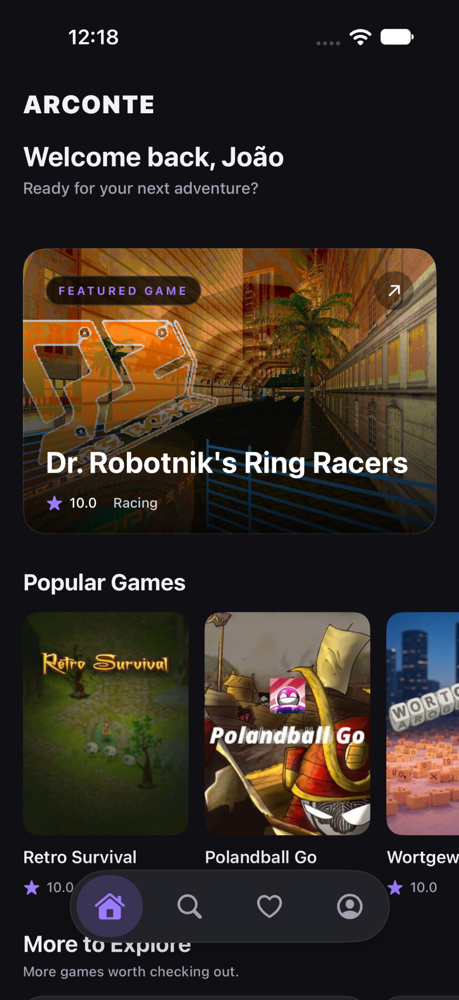
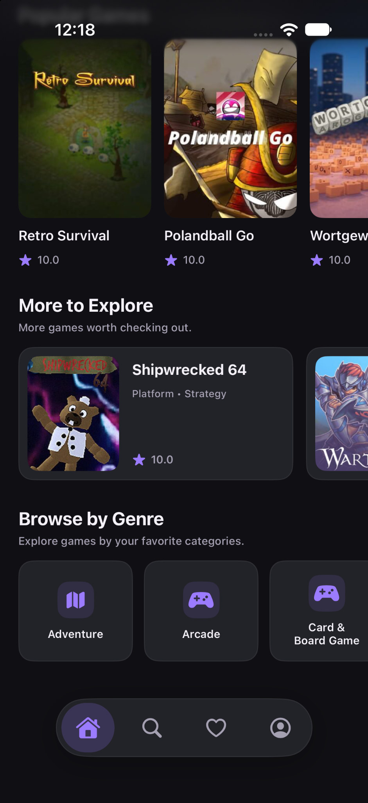
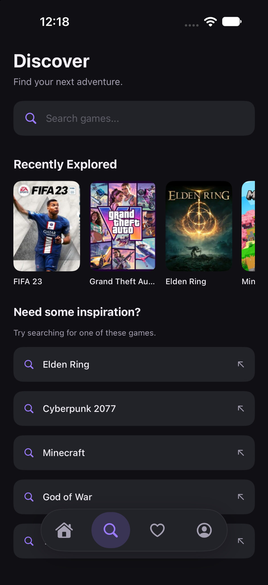
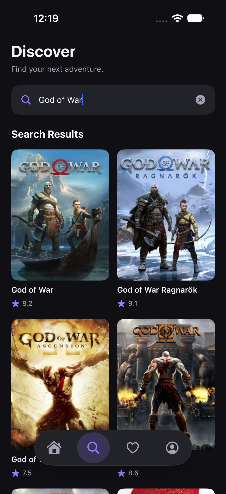
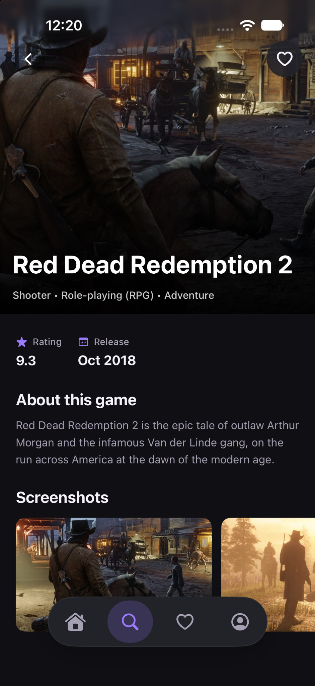
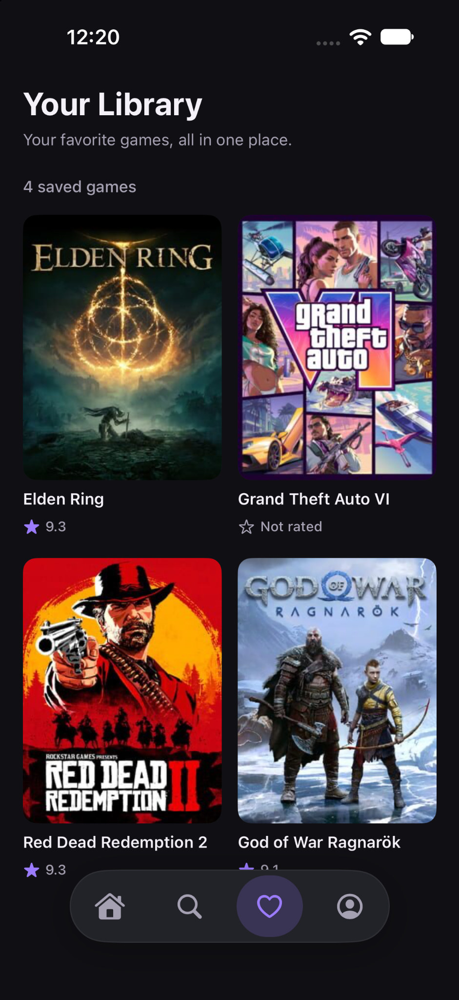
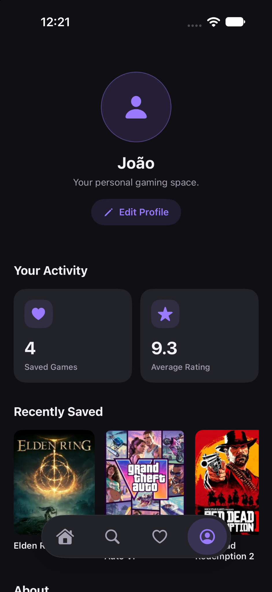
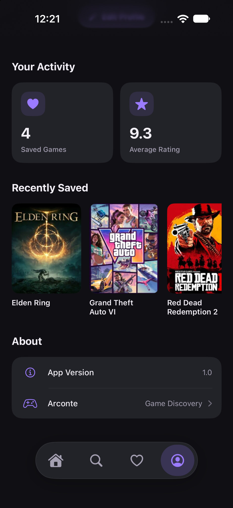

# Arconte

<p align="center">
  <strong>Discover your next adventure.</strong><br />
  A native iOS experience for discovering games, exploring their details, and building a personal collection.
</p>

<p align="center">
  
  
  
</p>

## Overview

**Arconte** is a game discovery app built with SwiftUI. It helps players explore popular titles, search for games, learn more about each title, and keep track of games they want to revisit.

The app consumes a REST API powered by **Cloudflare Workers**, which connects to **IGDB** for game information and artwork. Favorites and recently viewed games are stored locally with SwiftData, so a personal collection remains available between app launches.

## Features

- **Home discovery** — explore a featured game, popular titles, additional games, and genre categories.
- **Game search** — search the catalog with debounced input and a two-character minimum query.
- **Infinite scrolling** — load search results in pages of 20 as the user approaches the end of the list.
- **Game details** — view a game's description, rating, release information, genres, platforms, cover art, and available screenshots.
- **Favorites** — save and remove games from a persistent personal collection.
- **Recently explored** — revisit the five most recently opened games directly from the Search screen.
- **Personal profile** — customize a nickname and avatar, with preferences stored locally.
- **Custom navigation and dark interface** — a purpose-built floating tab bar and a visual system centered around Arconte's dark palette and purple accent.

## Screenshots

The screenshots below show the main discovery, search, collection, and profile experiences in Arconte.

### Home

<p align="center">
  
  
</p>

<p align="center"><sub>Featured games, popular titles, additional discoveries, and genre highlights.</sub></p>

### Search

<p align="center">
  
  
</p>

<p align="center"><sub>Recently explored titles, suggested searches, and live search results.</sub></p>

### Game details and favorites

<p align="center">
  
  
</p>

<p align="center"><sub>Game information and a locally persisted personal game library.</sub></p>

### Profile

<p align="center">
  
  
</p>

<p align="center"><sub>Personal profile, collection statistics, recently saved games, and app information.</sub></p>

## Tech Stack

| Technology             | Usage                                                              |
| ---------------------- | ------------------------------------------------------------------ |
| **Swift**              | Main programming language                                          |
| **SwiftUI**            | Declarative user interface                                         |
| **Swift Concurrency**  | Asynchronous networking with `async`/`await` and task cancellation |
| **Observation**        | View-model state with `@Observable`                                |
| **SwiftData**          | Local persistence for favorites and recently viewed games          |
| **URLSession**         | HTTP requests to the REST API                                      |
| **Cloudflare Workers** | Backend API layer                                                  |
| **IGDB**               | Game metadata and artwork source                                   |

## Architecture

Arconte uses a **feature-oriented project structure**, with MVVM applied to screens that contain more substantial presentation logic. Networking and persistence concerns are kept separate from the UI.

```text
Arconte/
├── ArconteApp.swift
├── Assets.xcassets/
├── Core/
│   ├── Extensions/
│   │   └── ArconteColors.swift
│   ├── Networking/
│   │   ├── APIClient.swift
│   │   ├── APIEndpoint.swift
│   │   └── APIError.swift
│   └── Persistence/
│       ├── FavoriteGame.swift
│       └── RecentlyViewedGame.swift
├── Features/
│   ├── Favorites/
│   │   ├── Components/
│   │   └── Views/
│   ├── GameDetails/
│   │   ├── ViewModels/
│   │   └── Views/
│   ├── Home/
│   │   ├── Components/
│   │   ├── ViewModels/
│   │   └── Views/
│   ├── Navigation/
│   ├── Profile/
│   │   └── Views/
│   └── Search/
│       ├── Components/
│       ├── ViewModels/
│       └── Views/
├── Models/
│   └── Game.swift
└── Services/
    └── GameService.swift
```

### Data flow

- **Views** render the interface and forward user actions.
- **ViewModels** coordinate screen state and asynchronous operations where needed.
- **GameService** provides app-level methods for fetching popular games, searching, and loading game details.
- **APIClient** builds requests, validates HTTP responses, decodes JSON, and exposes networking errors.
- **SwiftData** stores user-specific favorites and recent game history on the device.

## Backend API

The iOS app communicates with the Arconte API deployed on Cloudflare Workers. The Worker acts as the boundary between the app and IGDB, keeping provider credentials out of the iOS codebase.

**Current API base URL:**

```text
https://arconte-api.joaogkvalho.workers.dev
```

| Method | Endpoint                                | Description                               |
| ------ | --------------------------------------- | ----------------------------------------- |
| `GET`  | `/health`                               | Check API availability                    |
| `GET`  | `/games`                                | Retrieve popular games                    |
| `GET`  | `/games?search={query}&offset={offset}` | Search games with offset-based pagination |
| `GET`  | `/games/{id}`                           | Retrieve a game's details                 |

Search requests require at least two characters. Search results are loaded in pages of 20, using the `offset` query parameter.

> **Security note:** IGDB credentials belong on the backend and should never be embedded in the iOS app. The app only communicates with the Worker endpoint.

## Getting Started

### Requirements

- A Mac running a macOS version supported by your installed Xcode.
- Xcode compatible with the project's configured iOS deployment target.
- An iOS Simulator or a compatible iPhone for running the app.
- Network access to the Arconte API.

### Run the app

1. Clone or download this repository.
2. Open the project’s `.xcodeproj` file in Xcode.
3. Select the Arconte app scheme and an iOS Simulator or connected device.
4. Build and run the app.

The app is configured to use the deployed Arconte API. To point it to another environment, update the `baseURL` in `Core/Networking/APIClient.swift` to the appropriate backend URL. Do not add IGDB credentials to the iOS target.

## Local Data

Arconte uses SwiftData for data that belongs to the user:

- **Favorites** are stored with the game's identifier, name, cover URL, rating, and date added.
- **Recently viewed games** are stored with the game's identifier, name, cover URL, rating, and last viewed date. The Search screen displays the five most recent entries.
- **Profile preferences** such as the user's nickname and selected avatar are stored locally using `@AppStorage`.

## Data Attribution

Game information and artwork are provided by **IGDB**. Arconte is an independent portfolio project and is not affiliated with IGDB or the owners of the games represented in the catalog.

## Project Focus

This project was built to explore and demonstrate native iOS development practices, including:

- Building a multi-screen SwiftUI application with a consistent custom design system.
- Structuring feature code and separating UI state from networking logic.
- Performing asynchronous API requests with Swift Concurrency.
- Handling loading, empty, and error states in a user-facing application.
- Implementing debounced search and offset-based infinite scrolling.
- Persisting user data locally with SwiftData and `@AppStorage`.
- Integrating a server-side API without exposing third-party credentials in the client.

---

<p align="center">
  Built with SwiftUI for iOS.
</p>
